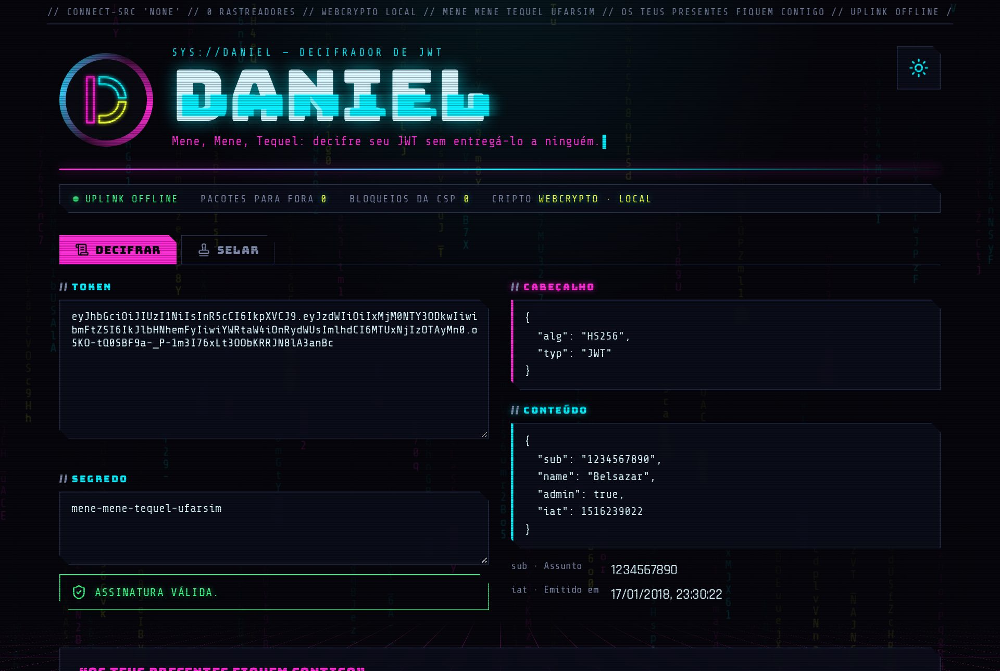

# 📜 Daniel

Decodifique, verifique e assine JWT direto no navegador. Nada sai da sua máquina.

> "Os teus presentes fiquem contigo; todavia lerei ao rei a escritura." (Daniel 5:17)



## Transparência

> "Os teus presentes fiquem contigo." Este site lê seu token e não leva nada.

Não confie: confira. Tudo o que está abaixo dá para checar sem acreditar em ninguém.

### O que o site promete

| Promessa | Como é garantido |
| --- | --- |
| **Nada sai do navegador** | A CSP de [`vercel.json`](vercel.json) tem `connect-src 'none'`: o navegador recusa qualquer `fetch`, XHR, WebSocket ou beacon. |
| **Sem servidor** | Assinar e verificar usam a WebCrypto nativa do navegador. Não existe API. |
| **Sem rastreio** | Nada de cookie, analytics, CDN ou script de terceiros. Fontes (Bungee, Rajdhani, Share Tech Mono) e ícones (Lucide) vêm do próprio site. |
| **Código pequeno e aberto** | A criptografia inteira cabe em [`src/jwt/`](src/jwt) (~150 linhas). A tela fica em [`src/ui/`](src/ui). O JS publicado não importa nada de fora. |
| **Build rastreável** | Cada release tem atestação de proveniência assinada pelo GitHub. O rodapé mostra a versão e o commit no ar, com link para o código exato. |

### O painel no topo da tela

| Item | O que mostra |
| --- | --- |
| **Pacotes para fora** | Quantos arquivos a página baixou de outro domínio, medido ao vivo (`PerformanceObserver`, o mesmo dado da aba Network). Deve ficar em 0. |
| **Bloqueios da CSP** | Quantas vezes o navegador barrou algo proibido, como uma tentativa de enviar dados. Se alguém adulterar o JS para vazar seu token, sobe. |
| **Uplink offline** / **Cripto webcrypto · local** | Rótulos fixos: lembram as garantias acima, não medem nada. |

### Confira você mesmo

1. **Rede:** abra o DevTools na aba Network, cole um token e veja que nenhuma requisição sai.
2. **CSP no ar:** `curl -sI https://daniel-jwt.vercel.app | grep -i content-security-policy`
3. **Código:** leia [`src/jwt/`](src/jwt) antes de colar um token de produção.
4. **Release:** `gh attestation verify daniel-jwt-vX.Y.Z.zip --repo stanleygomes/daniel-jwt`
5. **Offline:** baixe o zip da release (ou clone e `npm run build`), sirva o `dist/` localmente e desligue a internet.

## Funciona com

| Família | Algoritmos | Chave |
| --- | --- | --- |
| HMAC | HS256, HS384, HS512 | segredo |
| RSA | RS256…512, PS256…512 | PEM (PKCS#8/SPKI) ou JWK |
| ECDSA | ES256, ES384, ES512 | PEM (PKCS#8/SPKI) ou JWK |
| EdDSA | Ed25519 | PEM (PKCS#8/SPKI) ou JWK |

## Rodar

Node 24+.

```bash
npm install
npm run dev       # desenvolvimento
npm test          # testes (node --test, TypeScript direto)
npm run build     # tsc + vite build → dist/
npm run preview   # serve o dist/ com a mesma CSP da produção
```

## Deploy

Vercel: importe o repo. O preset Vite é detectado sozinho; o `vercel.json` só adiciona os cabeçalhos de segurança.

## Release

```bash
npm version patch   # ou minor / major: sobe o package.json, commita e cria a tag
git push --follow-tags
```

A tag dispara o [`release.yml`](.github/workflows/release.yml): testa, gera o build e publica a release com
o site em zip, o `SHA256SUMS` e uma [atestação de proveniência](https://docs.github.com/actions/security-for-github-actions/using-artifact-attestations)
assinada pelo GitHub. Para conferir que o zip veio deste repositório:

```bash
gh attestation verify daniel-jwt-v1.0.0.zip --repo stanleygomes/daniel-jwt
```

O rodapé do site mostra a versão e o commit que está no ar.

## Licença

[MIT](LICENSE)
